# IAQI brand

Logos, favicon and house style for the **International Association for Quantum Information (IAQI)** and its conferences (QIP, QCrypt, TQC).

**Browse it as a page:** <https://iaqi.github.io/iaqi-brand/>. The page has every variant on light, dark and maroon backgrounds, colours you can copy, and download links.

- [Which file to use](#which-file-to-use)
- [Logo variants](#logo-variants)
- [Colours](#colours)
- [Clear space and minimum size](#clear-space-and-minimum-size)
- [Favicon and app icons](#favicon-and-app-icons)
- [Typography](#typography)
- [Don'ts](#donts)
- [Files in this repo](#files-in-this-repo)
- [Usage terms](#usage-terms)

## Which file to use

| You are making… | Use | File |
|---|---|---|
| A website header or navigation bar | Horizontal logo, or the mark when space is tight | [`iaqi-logo-horizontal.svg`](logos/svg/iaqi-logo-horizontal.svg), [`iaqi-mark-coloured.svg`](logos/svg/iaqi-mark-coloured.svg) |
| A browser tab icon, or a phone home-screen icon | Favicon set | [`favicon/`](favicon/) (see [below](#favicon-and-app-icons)) |
| Slides (title slide) | Full logo, coloured | [`iaqi-logo-coloured.svg`](logos/svg/iaqi-logo-coloured.svg) |
| Slides (footer of every slide) | Horizontal logo, or the mark | [`iaqi-logo-horizontal.svg`](logos/svg/iaqi-logo-horizontal.svg) |
| Letterheads, posters, programme booklets | Full logo or horizontal logo, as SVG | [`logos/svg/`](logos/svg/) |
| An email signature | Horizontal logo, 240×56 PNG | [`iaqi-logo-horizontal-240x56.png`](logos/png/iaqi-logo-horizontal-240x56.png) |
| A social-media avatar | The mark on white, or the white mark on maroon | [`iaqi-mark-coloured-200.png`](logos/png/iaqi-mark-coloured-200.png), [`iaqi-mark-white.jpg`](logos/jpg/iaqi-mark-white.jpg) |
| Anything on a maroon, dark or photo background | White variants | [`iaqi-logo-white.svg`](logos/svg/iaqi-logo-white.svg), [`iaqi-mark-white.svg`](logos/svg/iaqi-mark-white.svg) |
| Single-colour print (stamps, embossing, fax, newspaper) | Black variants | [`iaqi-logo-black.svg`](logos/svg/iaqi-logo-black.svg), [`iaqi-mark-black.svg`](logos/svg/iaqi-mark-black.svg) |
| A tool that can't take SVG or transparent PNG (some forms and office tools) | JPEG | [`logos/jpg/`](logos/jpg/) |

**Prefer SVG.** It is sharp at every size and is the smallest file. Use PNG when a tool doesn't accept SVG. The large PNGs are 4500px wide; scale them down before putting them on a web page. The 200px and 240×56 PNGs are already web-sized.

## Logo variants

The **logo** is the mark plus the wording "International Association for Quantum Information". The **mark** is the rings with "IAQI", without the wording. Use the mark when the full name already appears nearby, or when there is no room for the wording.

| | Coloured | Black | White |
|---|---|---|---|
| **Logo** | 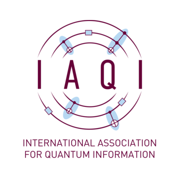 | 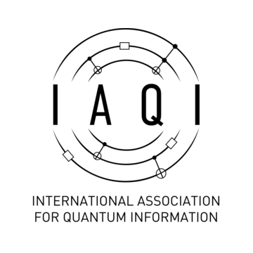 | 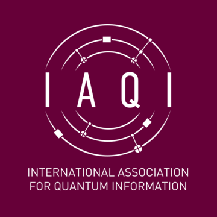 |
| **Mark** | 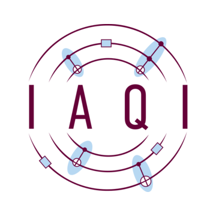 | 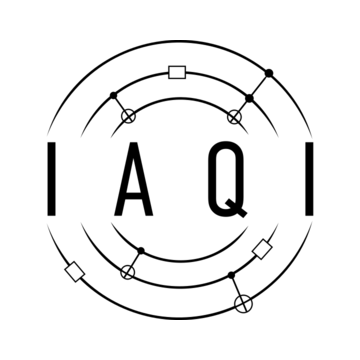 | 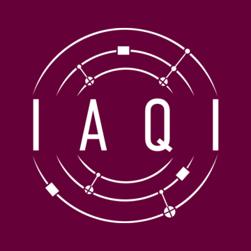 |

**Horizontal logo.** The mark with the wording beside it, for wide, short spaces such as headers, footers and signatures.

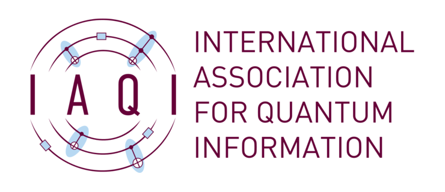

- **Coloured** is the default. Use it on white or light backgrounds.
- **Black** is for single-colour reproduction only.
- **White** is for maroon, dark or photographic backgrounds.

## Colours

| | Name | Hex | RGB | Use |
|---|---|---|---|---|
|  | IAQI maroon | `#660038` | 102 0 56 | Lines, lettering, backgrounds for the white logo |
|  | IAQI light blue | `#B7D8F2` | 183 216 242 | Accent: the ellipses and gates in the mark |
|  | White | `#FFFFFF` | 255 255 255 | Backgrounds, the white logo |
| 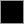 | Black | `#000000` | 0 0 0 | The black logo only |

The CMYK and Pantone values for print are **to be supplied** by the designer. Until then, give the printer the hex values and a PDF or SVG.

Maroon and white have a contrast ratio of 13:1, so maroon text on white (and white on maroon) passes WCAG AAA. Maroon on light blue is 8.7:1, also fine for text. Light blue on white is only 1.5:1: use it as a fill or accent, never for text or thin lines on white.

## Clear space and minimum size

*These are recommendations, not rules set by the designer.*

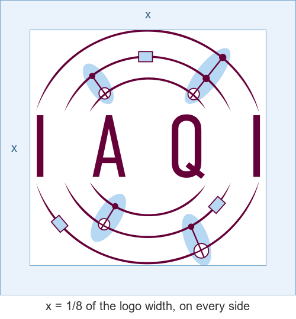

- **Clear space.** Keep at least ⅛ of the logo's width free of text and other graphics on every side.
- **Minimum size, mark:** 48px on screen, about 12mm in print. Below that, use the [favicon](#favicon-and-app-icons), which is drawn to be legible at small sizes.
- **Minimum size, full logo with wording:** 200px wide on screen, about 30mm in print. Below that the wording can't be read, so use the mark instead.
- **Minimum size, horizontal logo:** 56px tall on screen, the size of the 240×56 PNG.

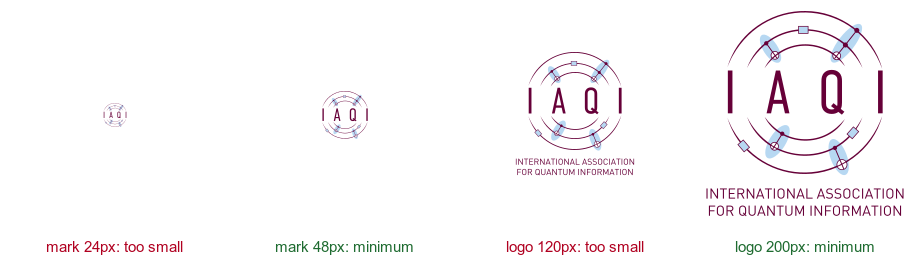

## Favicon and app icons

The rings in the mark blur into nothing at browser-tab size. The favicon is therefore a separate drawing: "IAQI" in white on a maroon tile.

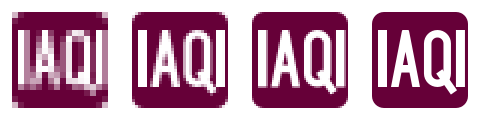

| File | Size | Used by |
|---|---|---|
| [`favicon.svg`](favicon/favicon.svg) | vector | Chrome, Firefox, Edge |
| [`favicon.ico`](favicon/favicon.ico) | 16, 32, 48 | Safari, older browsers |
| [`apple-touch-icon.png`](favicon/apple-touch-icon.png) | 180 | iPhone and iPad home screens |
| [`icon-192.png`](favicon/icon-192.png), [`icon-512.png`](favicon/icon-512.png) | 192, 512 | Android home screens, web app manifest |

Copy the [`favicon/`](favicon/) folder to your site and add this to `<head>`:

```html
<link rel="icon" href="/favicon.ico" sizes="any">
<link rel="icon" type="image/svg+xml" href="/favicon.svg">
<link rel="apple-touch-icon" href="/apple-touch-icon.png">
<link rel="manifest" href="/site.webmanifest">
```

and use [`site.webmanifest`](favicon/site.webmanifest) for the icons.

## Typography

The logo wording is set in **FF DIN** (Albert-Jan Pool, FontShop, now Monotype). Never retype it; always use the artwork. FF DIN is a commercial font, so it is not in this repo; the SVGs have the wording converted to outlines and need no font.

*Suggestion:* for headings and documents in IAQI's style, **[Barlow](https://fonts.google.com/specimen/Barlow)** is a good match: a free font (SIL Open Font License) with a DIN-like, slightly rounded look. It is built into Google Docs and Google Slides, and the portfolio page uses it.

## Don'ts

- Don't recolour the logo, except to use the black or white variant.
- Don't stretch, squash or rotate it.
- Don't add shadows, outlines, glows or gradients.
- Don't retype or re-arrange the wording, or set it in another font.
- Don't put the coloured logo on maroon, dark or busy backgrounds; use the white variant.
- Don't use the large logo as a favicon; use the [favicon set](#favicon-and-app-icons).

The [portfolio page](https://iaqi.github.io/iaqi-brand/#donts) shows each of these.

## Files in this repo

```
logos/svg/   vector logos (text converted to outlines, so no font is needed)
logos/png/   transparent PNGs: 4500px masters, plus 200px and 240x56 web sizes
logos/jpg/   flattened JPEGs (white backgrounds, or maroon for the white variants)
favicon/     favicon and app icons (favicon.svg is the master drawing)
source/      the designer's Adobe Illustrator working file
previews/    images used by this README
tools/       build.sh: rebuilds everything above from the designer's files
```

The files were renamed from the designer's originals, which have spaces in their names, to names that work in URLs:

| Original | In this repo |
|---|---|
| `IAQI logo coloured.svg` / `.png`, `IAQI logo _coloured.jpg` | `iaqi-logo-coloured.*` (same for black and white) |
| `IAQI logo coloured - no text.*` | `iaqi-mark-coloured.*` (same for black and white) |
| `IAQI logo coloured - no text 200px.png` | `iaqi-mark-coloured-200.png` |
| `IAQI logo horizontal.svg`, `IAQI logo horizontal logo.png` | `iaqi-logo-horizontal.*` |
| `IAQI logo horizontal 240x56.png` / `horizontal white 240x56.png` | `iaqi-logo-horizontal-240x56.png` / `iaqi-logo-horizontal-white-240x56.png` |

Changes from the originals:
- **SVG text outlined.** The SVGs with wording had it as live text in FF DIN, which most computers don't have. It is now converted to outlines.
- **`iaqi-logo-white.jpg` rebuilt.** The original export was white on white (blank). It is now white on maroon, like `iaqi-mark-white.jpg`.
- **New favicon set.** It replaces the earlier full-logo favicon.

Gaps: there is no white horizontal logo as SVG or large PNG, only the 240×56 PNG.

To rebuild everything from the designer's folder (needs Inkscape and ImageMagick 7), run:

```sh
tools/build.sh "/path/to/Logo files"
```

## Usage terms

The IAQI name and logo belong to IAQI and are **not** under an open licence. They may be used to refer to IAQI, its conferences (QIP, QCrypt, TQC) and activities IAQI supports, following this guide. For any other use, contact IAQI.
